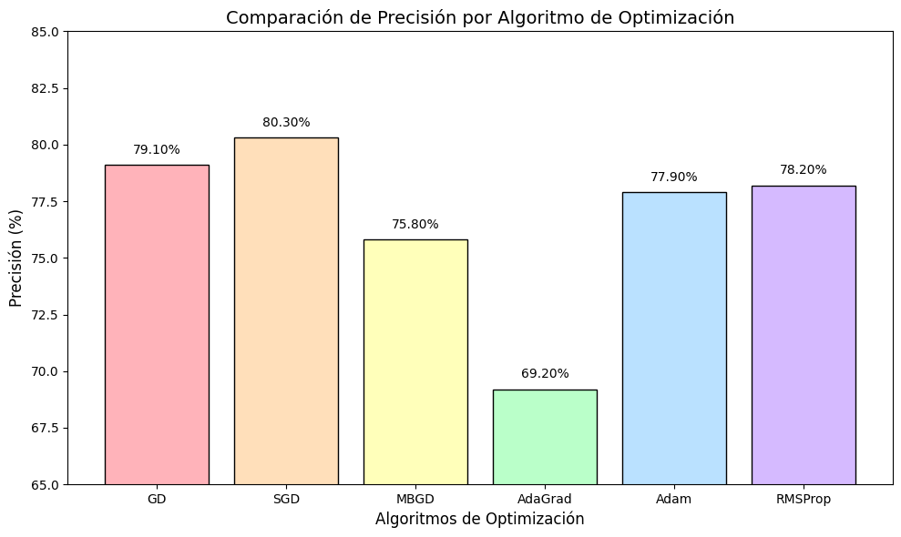
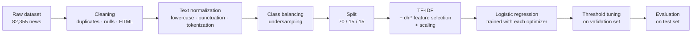

<div align="center">

# Gradient-Based Optimization for Political Fake News Detection

**Comparing six gradient-descent optimizers for logistic regression on Spanish political news**


</div>

---

## Table of Contents

- [Overview](#overview)
- [Key Results](#key-results)
- [Dataset](#dataset)
- [Pipeline](#pipeline)
- [Optimizers Implemented](#optimizers-implemented)
- [Repository Structure](#repository-structure)
- [Getting Started](#getting-started)
- [Detailed Results](#detailed-results)
- [Limitations and Future Work](#limitations-and-future-work)
- [Author](#author)

---

## Overview

This project studies how the choice of **optimization algorithm** affects the performance of a **logistic regression** classifier that separates real from fake political news written in Spanish.

The model stays the same: a linear layer with a sigmoid output trained on TF-IDF features. Only the optimizer changes. Six gradient-based methods are **implemented by hand** (the parameter update rules are written explicitly instead of using `torch.optim`) and compared against a scikit-learn `LogisticRegression` baseline:

| | Optimizer | Implementation |
|---|---|---|
| 1 | Gradient Descent (GD) + momentum | NumPy, written from scratch |
| 2 | Stochastic Gradient Descent (SGD) + momentum | PyTorch, manual update step |
| 3 | Mini-Batch Gradient Descent (MBGD) + momentum + L2 | PyTorch, manual update step |
| 4 | AdaGrad | PyTorch, custom optimizer class |
| 5 | Adam | PyTorch, custom optimizer class |
| 6 | RMSProp | PyTorch, custom optimizer class |

## Key Results

Performance on the held-out **test set** (11,142 samples):

| Model | Accuracy | Precision | Recall | F1-Score |
|---|:---:|:---:|:---:|:---:|
| **GD** | **0.786** | 0.791 | 0.773 | **0.782** |
| **SGD** | 0.784 | **0.803** | 0.747 | 0.774 |
| RMSProp | 0.766 | 0.782 | 0.730 | 0.755 |
| Adam | 0.763 | 0.780 | 0.728 | 0.753 |
| MBGD | 0.746 | 0.759 | 0.716 | 0.737 |
| AdaGrad | 0.729 | 0.692 | **0.816** | 0.749 |
| *Baseline: scikit-learn `LogisticRegression`* | *0.744* | *0.737* | *0.752* | *0.745* |

**Highlights**

- **GD with momentum** reached the best accuracy (78.6%) and F1-score (0.782).
- **SGD with momentum** reached the highest precision (80.3%), the main target metric of the study.
- Every tuned optimizer except AdaGrad beat the scikit-learn baseline on accuracy and precision. The baseline reached 86.4% accuracy on the training set but only 74.4% on test, so it overfits.
- AdaGrad had the highest recall (0.816) but the lowest precision, so it flags more news as real at the cost of more false positives.

<div align="center">
  
  <br>
  <sub>Test-set precision for each optimizer (generated in <code>complementos/porcentajesComparación.ipynb</code>)</sub>
</div>

## Dataset

- **Source:** [Spanish Political News Dataset (Kaggle)](https://www.kaggle.com/datasets/javierespaol/spanish-political-news-dataset)
- **Original columns:** `Label`, `Titulo` (title), `Descripcion` (description), `Fecha` (date)
- **Labels:** `0` = fake news, `1` = real news

| Stage | Records | Class 0 / Class 1 |
|---|---:|---|
| Raw dataset | 82,355 | 37,310 / 45,045 |
| After cleaning (duplicates, nulls, placeholders) | 82,041 | 37,138 / 44,903 |
| After balancing (undersampling) | **74,276** | 37,138 / 37,138 |

**Data split** (random shuffle, `random_state=42`):

| Subset | Share | Records |
|---|:---:|---:|
| Training | 70% | 51,993 |
| Validation | 15% | 11,141 |
| Test | 15% | 11,142 |

## Pipeline



### 1. Data engineering (`IngenieriaDatos_100.ipynb`)

- Remove 313 duplicate rows and rows with missing values.
- Drop placeholder entries ("Sin título", "Sin descripción", "Sin fecha").
- Strip HTML with **BeautifulSoup** and remove typographic characters (`«`, `»`, `[…]`).
- Normalize text: lowercase, strip punctuation and special characters, collapse whitespace, tokenize with **NLTK**.
- Balance the classes by **undersampling** the majority class.
- Merge title and description into a single `Texto` field and export the train/validation/test CSV files.

### 2. Feature extraction

| Notebooks | Vectorization | Feature selection | Scaling |
|---|---|---|---|
| GD, SGD, MBGD | `TfidfVectorizer` with n-grams, 10k–15k features | `SelectKBest(chi2)`, k = 3,000–5,000 | `StandardScaler(with_mean=False)` + row-norm normalization |
| Adam, AdaGrad, RMSProp | `TfidfVectorizer`, 20k–30k features | none | none |

### 3. Training and evaluation

- Binary cross-entropy loss, with **class weights** in the adaptive optimizers.
- **Early stopping** on validation loss for Adam, AdaGrad and RMSProp.
- The **decision threshold** is tuned on the validation set (for example, aiming for a precision of 0.79–0.80), then applied unchanged to the test set.
- Metrics: accuracy, precision, recall, F1-score, specificity and the confusion matrix, plus learning curves.

## Optimizers Implemented

| Optimizer | Learning rate | Batch size | Other hyperparameters | Threshold |
|---|:---:|:---:|---|:---:|
| GD | 0.001 | full batch | momentum = 0.9, decay = 1e-12, pos_weight = 1.1, 5,000 epochs | 0.60 |
| SGD | 0.0001 | — | momentum = 0.9 | tuned |
| MBGD | 0.005 | 64 | momentum = 0.9, weight decay = 1e-4, 3,000 epochs | 0.55 |
| AdaGrad | 0.0001 | 128 | weight decay = 0.01, ε = 1e-8, early stopping (patience 30) | 0.50 |
| Adam | 0.0001 | 256 | β = (0.9, 0.999), ε = 1e-8, early stopping (patience 20) | 0.54 |
| RMSProp | 0.00005 | 256 | α = 0.99, ε = 1e-8, early stopping (patience 20) | 0.54 |

## Repository Structure

```
TIC_Optimizacion_GD/
├── IngenieriaDatos_100.ipynb        # Data cleaning, normalization, balancing and split
├── RegresionLogistica.ipynb         # Baseline: scikit-learn LogisticRegression
├── GD_Gradiente.ipynb               # Batch Gradient Descent (NumPy, from scratch)
├── SGD_Estocastico.ipynb            # Stochastic Gradient Descent (PyTorch)
├── MBGD.ipynb                       # Mini-Batch Gradient Descent (PyTorch)
├── AdaGrad.ipynb                    # AdaGrad (custom PyTorch optimizer)
├── ADAM.ipynb                       # Adam (custom PyTorch optimizer)
├── RMSProp.ipynb                    # RMSProp (custom PyTorch optimizer)
├── complementos/
│   ├── metricasComparacion.ipynb    # SGD vs. baseline metric comparison
│   └── porcentajesComparación.ipynb # Precision comparison across optimizers
├── datasets_Completo/
│   ├── DatasetFinal.csv             # Raw dataset
│   └── dataset_preOptimization.csv  # Cleaned dataset
├── divisonDatos/
│   ├── train_data.csv               # 70% training split
│   ├── val_data.csv                 # 15% validation split
│   └── test_data.csv                # 15% test split
├── dataset_preOptimization.csv      # Preprocessed dataset (output of data engineering)
└── docs/images/                     # Figures used in this README
```

## Getting Started

### Prerequisites

- Python 3.11 or later
- Jupyter Notebook or JupyterLab
- *(Optional)* A CUDA-capable GPU. The PyTorch notebooks fall back to the CPU when no GPU is available.

### Installation

```bash
# 1. Clone the repository
git clone https://github.com/santy10e/TIC_Optimizacion_GD.git
cd TIC_Optimizacion_GD

# 2. Create and activate a virtual environment
python -m venv .venv
source .venv/bin/activate        # Windows: .venv\Scripts\activate

# 3. Install dependencies
pip install numpy pandas scipy scikit-learn torch matplotlib seaborn nltk spacy beautifulsoup4 jupyter

# 4. Download the NLP resources
python -m spacy download es_core_news_sm
python -c "import nltk; nltk.download('stopwords'); nltk.download('punkt')"
```

### Usage

1. **(Optional) Regenerate the data splits** by running `IngenieriaDatos_100.ipynb`. The resulting splits are already included in `divisonDatos/`.
2. **Train the baseline** with `RegresionLogistica.ipynb`.
3. **Train each optimizer** by running any of `GD_Gradiente.ipynb`, `SGD_Estocastico.ipynb`, `MBGD.ipynb`, `AdaGrad.ipynb`, `ADAM.ipynb` or `RMSProp.ipynb`.
4. **Compare the results** in the notebooks under `complementos/`.

```bash
jupyter notebook
```

> **Note:** The notebooks read the CSV files with relative paths, so start Jupyter from the repository root.

## Detailed Results

<details>
<summary><b>Validation vs. test metrics per optimizer</b></summary>

| Model | Set | Accuracy | Precision | Recall | F1 |
|---|---|:---:|:---:|:---:|:---:|
| GD | Validation | 0.780 | 0.800 | 0.761 | 0.780 |
| GD | Test | 0.786 | 0.791 | 0.773 | 0.782 |
| SGD | Validation | 0.777 | 0.813 | 0.735 | 0.772 |
| SGD | Test | 0.784 | 0.803 | 0.747 | 0.774 |
| MBGD | Validation | 0.739 | 0.766 | 0.708 | 0.736 |
| MBGD | Test | 0.746 | 0.759 | 0.716 | 0.737 |
| AdaGrad | Validation | 0.740 | 0.715 | 0.822 | 0.765 |
| AdaGrad | Test | 0.729 | 0.692 | 0.816 | 0.749 |
| Adam | Validation | 0.760 | 0.790 | 0.725 | 0.756 |
| Adam | Test | 0.763 | 0.780 | 0.728 | 0.753 |
| RMSProp | Validation | 0.762 | 0.792 | 0.727 | 0.758 |
| RMSProp | Test | 0.766 | 0.782 | 0.730 | 0.755 |
| Baseline | Validation | 0.745 | 0.751 | 0.752 | 0.752 |
| Baseline | Test | 0.744 | 0.737 | 0.752 | 0.745 |

</details>

<details>
<summary><b>Test-set confusion matrices</b></summary>

Rows are the true class and columns the predicted class, ordered `[0 = fake, 1 = real]`.

| Model | TN | FP | FN | TP |
|---|---:|---:|---:|---:|
| GD | 4,491 | 1,130 | 1,254 | 4,267 |
| SGD | 4,612 | 1,009 | 1,396 | 4,125 |
| MBGD | 4,364 | 1,257 | 1,569 | 3,952 |
| Baseline | 4,141 | 1,480 | 1,367 | 4,154 |

</details>

## Limitations and Future Work

- **Linear model only.** Logistic regression on bag-of-words features cannot capture context. Transformer models such as BETO or RoBERTa-BNE are the natural next step.
- **Different feature pipelines.** The GD/SGD/MBGD notebooks use chi² feature selection, while the adaptive-optimizer notebooks use plain TF-IDF. Sharing one feature pipeline would isolate the effect of the optimizer.
- **Single run per configuration.** Repeating each experiment with several random seeds would give confidence intervals for the comparison.
- **Notebook-based code.** Moving the shared preprocessing and training loops into a Python package would make the experiments easier to reproduce.

## Author

**Santiago Tene** — [@santy10e](https://github.com/santy10e)

Developed as a final degree project (TIC) on applying optimization techniques to machine learning for misinformation detection.

---

<div align="center">
<sub>If you find this project useful, consider giving it a ⭐</sub>
</div>
